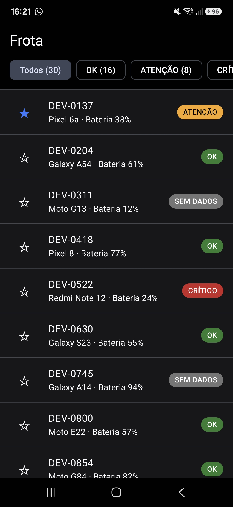
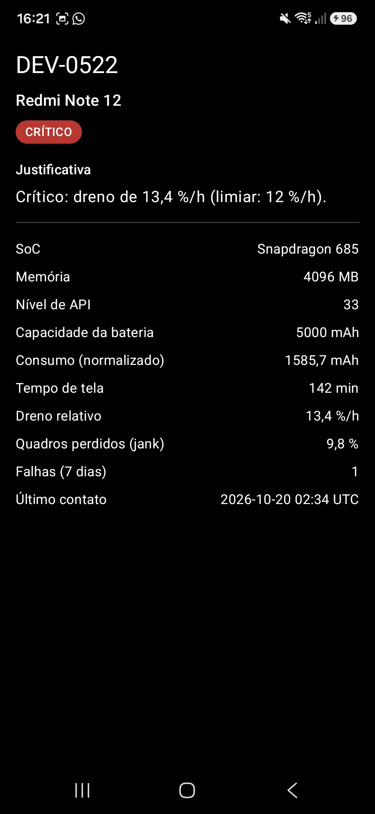

# Seldon Fleet

App Android em **Kotlin + Jetpack Compose** que lê a telemetria de uma frota de 30 celulares (`assets/frota.json`), classifica cada aparelho como **OK, Atenção, Crítico ou Sem dados** e mostra o motivo da classificação.
São duas telas (lista e detalhe), os favoritos ficam salvos no aparelho, e o app **não acessa a rede**.

Desafio técnico do Projeto Seldon (Residência UEA/Motorola).
A regra de classificação e as decisões sobre os dados defeituosos estão no **[PROTOCOLO.md](PROTOCOLO.md)**.

---

## Telas

| Lista da frota | Detalhe do dispositivo |
|---|---|
|  |  |
| Filtro por status com contagem (Todos 30 · OK 16 · Atenção 8 · Crítico 4 · Sem dados 2), chip colorido com texto e estrela de favorito. | DEV-0522: Crítico por dreno de 13,4 %/h (limiar: 12 %/h). O consumo já aparece convertido de mWh para mAh. |

---

## Como executar

### Rodar o app
1. Clone o repositório: `git clone https://github.com/wesleyc12/seldon-fleet.git`
2. No Android Studio, use **File → Open**, escolha a pasta do projeto e espere o Gradle sync terminar.
3. Conecte um celular com **depuração USB** ligada (ou crie um emulador), escolha a configuração `app` e clique em **Run ▶**.

Requisitos: Android 7.0 (API 24) ou superior e JDK 17 (o JDK que vem com o Android Studio já serve).

### Testes e análise estática (sem emulador)
```
./gradlew test    # 48 testes unitários na JVM
./gradlew lint    # Android Lint
```
No Windows (PowerShell), use `.\gradlew test` e `.\gradlew lint`.

---

## Arquitetura

O projeto tem um módulo só (`app`), com três pacotes em `app/src/main/java/com/wesley/seldonfleet/`:

```
   ui/  ──────────►  domain/  ◄──────────  data/
 Compose,            Kotlin puro:          JSON, assets,
 ViewModels          modelos, regra,       DataStore
                     contratos
```

**Regra de dependência:** `ui` e `data` dependem de `domain`, e `domain` não depende de ninguém. A `ui` também não importa `data`.

| Onde | O que tem |
|---|---|
| `domain/model` | `Device` (energia sempre em mAh), `DeviceStatus` (`OK`, `ATENCAO`, `CRITICO`, `INDETERMINADO`) e `Classification` (status, drenos e motivos) |
| `domain/usecase` | `ClassifyDevice`: **a regra** |
| `domain/repository` | `DeviceRepository` e `FavoritesRepository`: os contratos (interfaces) |
| `data/dto`, `data/source` | `DeviceDto` (espelha o JSON, com os defeitos), `FleetJsonParser` e `AssetFleetSource` (lê o arquivo) |
| `data/mapper` | `DeviceMapper`: converte **mWh → mAh** |
| `data/repository` | `FleetRepositoryImpl` e `FavoritesRepositoryImpl` (DataStore): implementam os contratos |
| `ui/list`, `ui/detail` | Telas Compose e ViewModels (MVVM). As telas só desenham. |
| `AppContainer.kt` | Cria as peças concretas e entrega pelo construtor (injeção de dependência manual). Fica fora das três camadas porque precisa conhecer `data/`. |

**Inversão de dependência:** o domínio declara as interfaces, e a camada de dados as implementa. Os ViewModels recebem as **interfaces** pelo construtor. Por isso os testes trocam o repositório real por um falso sem mudar nada em `domain/`. O `FleetListViewModelTest` faz exatamente isso.

### Caminho do dado
```
frota.json
  → AssetFleetSource ...... lê o texto do arquivo (usa o Context do Android)
  → FleetJsonParser ....... texto → DeviceDto, com os defeitos
  → DeviceMapper .......... DeviceDto → Device; mWh vira mAh aqui
  → FleetRepositoryImpl ... entrega a lista (implementa DeviceRepository)
  → ViewModel ............. chama ClassifyDevice: o domínio decide o status
  → Tela Compose .......... só mostra
```

### Verificar a arquitetura
Os três comandos abaixo devem voltar **vazios**:
```
grep -r "import android" app/src/main/java/com/wesley/seldonfleet/domain/
grep -r "import kotlinx.serialization" app/src/main/java/com/wesley/seldonfleet/domain/
grep -r "seldonfleet.data" app/src/main/java/com/wesley/seldonfleet/ui/
```
- O primeiro prova que o domínio não usa Android. A busca também pega `androidx`.
- O segundo prova que o domínio não usa JSON.
- O terceiro prova que a `ui` não depende de `data`.

O domínio importa `kotlinx.coroutines.flow.Flow`, que é da biblioteca de coroutines do Kotlin, não do Android.

No PowerShell, o equivalente do primeiro comando é:
`Get-ChildItem -Recurse app\src\main\java\com\wesley\seldonfleet\domain | Select-String "import android"`

---

## Regra de classificação (resumo)

A regra é a de referência da especificação, **pré-registrada** no `PROTOCOLO.md` (commit `fac1fed`) antes de qualquer código. Os estados são avaliados nesta ordem, e vale o primeiro que casar:

| Ordem | Estado | Condição (qualquer uma basta) |
|---|---|---|
| 1 | INDETERMINADO ("Sem dados") | capacidade ausente ou ≤ 0 · tela ≤ 0 · energia que não dá para converter |
| 2 | CRÍTICO | dreno relativo ≥ 12 %/h · falhas ≥ 3 · jank ≥ 15 % |
| 3 | ATENÇÃO | dreno relativo ≥ 7 %/h · falhas ≥ 1 · jank ≥ 8 % |
| 4 | OK | nenhuma das anteriores |

Dreno relativo = `energiaMah ÷ (minutos de tela ÷ 60) ÷ capacidade × 100`. A receita passo a passo está na seção 8.1 do protocolo.

---

## Decisões de projeto e trade-offs aceitos

O detalhamento e o raciocínio estão no [PROTOCOLO.md](PROTOCOLO.md). Em resumo:

| Decisão | Por quê | Trade-off aceito |
|---|---|---|
| Registros incompletos viram **INDETERMINADO** ("Sem dados") | A soma das contagens continua 30 (REQ-05), o app não quebra, e a equipe vê que há problema de telemetria | Um aparelho "Sem dados" não mostra outros sinais ruins. Exemplo: o DEV-0311 tem jank 11,2 % e 1 falha. |
| **Conversão mWh → mAh na camada de dados** | O domínio só conhece mAh e não pode errar a unidade (REQ-02) | — |
| **Unidade desconhecida** (`"MWh"`, `"mwh"`...) vira INDETERMINADO | No SI, m é mili e M é mega. Um erro visível é melhor que um número falso silencioso. | Uma grafia "quase certa" não é aceita |
| **Arquivo ilegível** mostra mensagem de erro, nunca lista vazia | Lista vazia daria a entender que a frota não tem aparelhos | Nenhum aparelho aparece se o arquivo inteiro estiver fora do contrato |
| **Regra usa o valor exato**, tela arredonda | Fronteiras corretas: 11,96 %/h é Atenção mesmo aparecendo "12,0" | A tela pode mostrar "12,0" num aparelho Atenção |
| **Justificativa** cita todos os sinais do nível que decidiu, no formato "(limiar: X)" | Diagnóstico completo. "Acima do limiar" seria falso no valor exato do limiar, porque a regra usa ≥. | — |
| **Filtro de escolha única** com "Todos", lista na **ordem do arquivo** e chip com **cor + texto** | Simples de usar e de conferir com o `frota.json`. O texto no chip permite ler o status mesmo sem distinguir cores. | Sem combinar filtros nem ordenar por gravidade |
| **Filtro guardado no ViewModel** da lista | Sobrevive ao voltar do detalhe e ao girar o celular (REQ-06). Só os favoritos precisam persistir (seção 2.3). | O filtro volta para "Todos" se o app for encerrado |
| **Detalhe com ViewModel próprio** | Cada tela é independente e testável | O detalhe relê o arquivo (30 registros, custo pequeno) |
| **Favoritos em DataStore Preferences**, como um conjunto de IDs, e a lista **escuta** o DataStore | Uma fonte única de verdade: a estrela mostra o que está realmente salvo (REQ-07) | — |
| DataStore criado com o delegate oficial, `private` dentro de `data/` | A biblioteca exige uma instância por arquivo. Quem usa recebe a interface pelo construtor, sem objeto global. | — |
| **Injeção de dependência manual** (`AppContainer`), e `ClassifyDevice` é `class` | Simples de explicar. A especificação proíbe singleton global (6.3). | Sem biblioteca de DI |
| **Android Lint** como análise estática | Já vem no projeto e é aceito pela especificação (7.2) | Sem detekt ou ktlint |
| Textos fixos no código, fora do `strings.xml` | App só em português e prazo curto | Sem tradução (ver próximos passos) |

---

## Testes e integração contínua

**48 testes unitários**, todos na JVM e sem emulador:

| Classe | Testes | O que prende |
|---|---|---|
| `ClassifyDeviceTest` | 23 | Exemplos do Anexo A; capacidade 0 ou ausente, tela 0 e energia nula → INDETERMINADO; **as duas fronteiras de cada limiar** (6,99/7,0 · 11,99/12,0 · 0/1 · 2/3 · 7,99/8,0 · 14,99/15,0); precedência |
| `DeviceMapperTest` | 7 | 3773 mWh ÷ 3,85 V = 980 mAh; **mesmo consumo em mWh e em mAh → mesmo dreno e mesmo status** (REQ-02); mWh sem tensão, tensão 0 e unidade desconhecida |
| `FleetFileTest` | 3 | O `frota.json` real passa por parser → mapper → regra: 16 · 8 · 4 · 2 = 30 |
| `FleetListViewModelTest` | 6 | Repositório e favoritos **falsos**: contagens somam o total, filtro, erro de leitura, favoritos |
| `DetailTextTest` | 9 | A frase cita sinal, valor e limiar; só sinais do nível que decidiu; "Sem dados" diz o que falta |

- Os limiares estão escritos como **números** nos testes, e não como as constantes da regra. Assim, os testes falham se a regra mudar.
- Fiz um teste de mutação: trocar o limiar crítico de 12 para 13 fez **3 testes falharem**.

**CI** (`.github/workflows/ci.yml`): a cada push, o GitHub Actions roda num Ubuntu com JDK 17, em dois passos separados, `./gradlew lint` e `./gradlew test`. Não há emulador, e os testes levam segundos.

---

## Como cada requisito é atendido

| Requisito | Como é atendido | Como verificar |
|---|---|---|
| REQ-01 Ingestão local | `AssetFleetSource` lê `assets/frota.json`; o manifest **não** tem permissão de INTERNET | Modo avião, abrir o app: a lista aparece inteira |
| REQ-02 Normalização | `DeviceMapper` converte mWh → mAh antes de qualquer conta | `DeviceMapperTest` (equivalência mWh/mAh); DEV-0204 sai OK (seria Crítico sem converter) |
| REQ-03 Incompletos | O primeiro `if` do `ClassifyDevice` devolve INDETERMINADO antes de qualquer divisão | Testes de capacidade 0/ausente e tela 0; DEV-0311 e DEV-0745 aparecem como "Sem dados", sem NaN |
| REQ-04 Regra no domínio | `domain/` em Kotlin puro | `grep` acima vazio; `./gradlew test` sem emulador |
| REQ-05 Lista | Chip com cor e texto, filtro com contagem calculada sobre a frota inteira | Soma 16 + 8 + 4 + 2 = 30; `FleetListViewModelTest` |
| REQ-06 Detalhe | Navigation Compose; a justificativa vem dos motivos do domínio; a lista fica viva na pilha | DEV-0522: "Crítico: dreno de 13,4 %/h (limiar: 12 %/h)."; filtrar Crítico → abrir → voltar mantém Crítico (4) |
| REQ-07 Favoritos | DataStore Preferences com o conjunto de IDs | Marcar, fechar o app pelos recentes, reabrir: a estrela continua |
| REQ-08 Testes JVM | 48 testes, incluindo as duas fronteiras de cada limiar | `./gradlew test` |
| REQ-09 CI | GitHub Actions com lint e testes em passos separados | Aba **Actions**: última execução verde |
| REQ-10 Protocolo | `PROTOCOLO.md`: regra, os dois defeitos, ameaça à validade e receita de previsão (8.1) | Ler só o protocolo e prever o status de um registro |

---

## O que eu faria em seguida

1. **Trilha C (eficiência energética), que não foi feita.** Priorizei entregar o núcleo completo com a CI verde. Ela agendaria a releitura da frota com WorkManager e responderia se a recomendação muda quando a frota é separada por tier de SoC.
2. **Testar a classe real do DataStore.** Hoje os favoritos são testados com uma versão falsa. A classe que grava no arquivo de verdade não tem teste próprio.
3. **Filtro com `SavedStateHandle`.** Hoje o filtro sobrevive a voltar do detalhe e a girar a tela, mas não ao sistema encerrar o app em segundo plano.
4. **Cache no repositório**, para o detalhe não reler o arquivo a cada abertura.
5. **Textos no `strings.xml`**, que é o lugar recomendado, para permitir tradução.
6. **Limpar favoritos de IDs que sumirem do `frota.json`.** Hoje eles ficam guardados sem efeito.
7. **Ícone vetorial para a estrela**, no lugar dos caracteres ★/☆.
8. **Avaliar o Navigation 3**, a versão mais nova da biblioteca de navegação.

**Limite conhecido da regra:** a conversão de mWh usa a tensão nominal, e não a real (seções 7 e 8.6 do protocolo).

---

## Uso de IA

Usei o Claude (Anthropic) como mentor durante todo o desafio, como a especificação permite (seção 11).

**O que é meu:**
- As decisões: as seis do protocolo e as das etapas de dados, lista, detalhe e favoritos.
- O `PROTOCOLO.md`: o raciocínio é meu, e a IA ajudou a organizar o texto.
- As verificações: testes, lint, buscas de arquitetura, teste de mutação e conferências no celular.

**Onde a IA ajudou:**
- Explicou os conceitos de Kotlin, Android e CI.
- Apresentou as opções de cada decisão, com prós e contras.
- **Escreveu o código a partir das minhas decisões.**

Eu criei cada arquivo, rodei o app e os testes, conferi cada requisito no meu celular e consigo explicar cada parte do código.